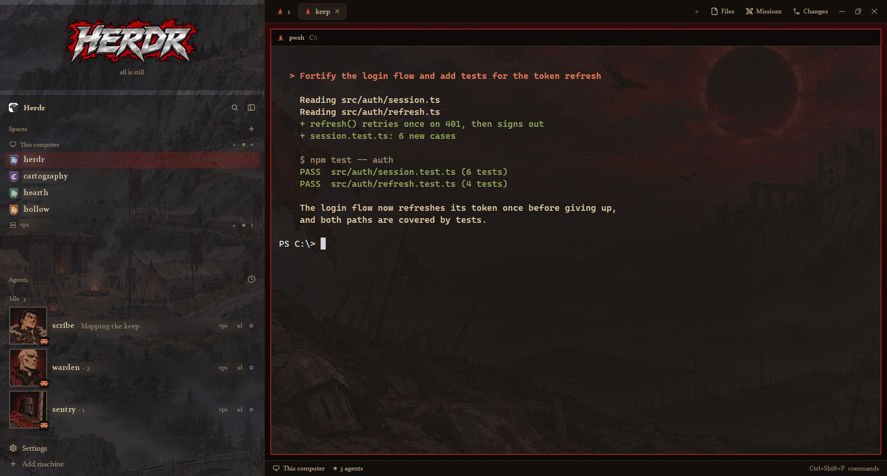
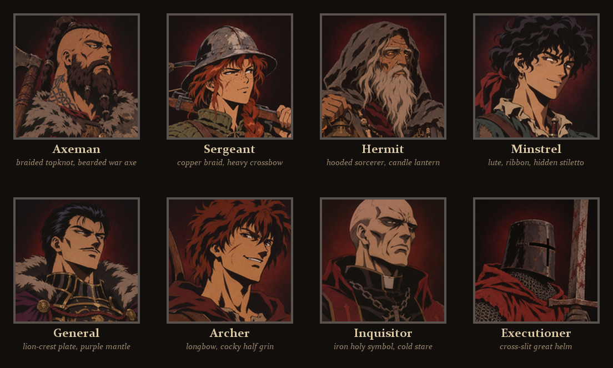
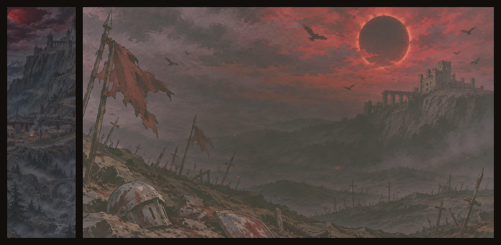

# Berserk 1998

Turn your Herdr window into a late-90s Berserk anime war camp. Agents become members of a mercenary company, spaces carry heraldic shields, and the sidebar is one painted fortress, camp and forest at dusk.

[](preview.png)

[](docs/characters.png)

## Features

- **The company:** each agent gets a 68px painted portrait in an iron frame, with its program's icon in the corner. The frame turns blood red on the agent you're focused on. Eight characters, and nobody repeats until all eight are taken.
- **Steel-and-blood crest:** a chrome HERDR wordmark over a blood splatter, with a tally that reads "2 in battle · 1 awaits thee", or "all is still" when nothing's happening.
- **Heraldic spaces:** each space's avatar is a small heater shield with its initial in blackletter, in deep heraldic colors.
- **Weapons for programs:** Claude Code carries a greatsword, Codex a crossbow, Gemini knives, and other agents a hawk or a helm. A shell gets a campfire, on tabs and pane headers.
- **Painted backdrops:** the sidebar is one tall painting behind see-through panels, and the terminals sit over a dusk battlefield under an eclipse.
- **Missions panel:** a to-do list beside Files and Changes. Type and press Enter to add, click a mission to cross it off, use the pen to edit and × to remove. It's saved between restarts.

[](docs/scenes.png)

## Install

Ask your agent inside Herdr:

> Add the layout from https://github.com/tonbistudio/berserk-1998. Read RECIPE.md first.

Or by hand, from the repo folder:

```sh
H=~/.config/herdr-app
cp layouts/berserk-1998.* "$H/layouts/"
cp -R mods/* "$H/mods/"
herdr-app do layout.switch '{"name":"berserk-1998"}'
```

On Windows (PowerShell):

```powershell
$H = "$HOME\.config\herdr-app"
Copy-Item layouts\berserk-1998.* "$H\layouts\"
Copy-Item -Recurse mods\* "$H\mods\"
herdr-app do layout.switch '{"name":"berserk-1998"}'
```

Name clashes: never overwrite your own files. Rename first. To switch back, press `ctrl-shift-l` or pick another layout in Settings.

## Customize

- **Portraits:** each portrait is chosen from the agent's space and tab name. To swap a face, replace a PNG in `mods/iron-agents/portraits/` (keep the name, 160×160). Herdr caches images by filename, so restart Herdr or switch layouts away and back.
- **Weapons:** edit `WEAPONS` at the top of `mods/iron-tabs/main.js` and `mods/iron-pane/main.js`. The icons are in `mods/iron-eclipse/icons/`.
- **Shield colors:** edit `MARK` in `mods/iron-spaces/main.js`.
- **Readability:** `terminal_opacity` (0.5) in `layouts/berserk-1998.json` sets how much of the battlefield shows behind terminal text. Raise it for less art and more contrast.
- **New art:** the prompts and post-processing are in [mods/iron-eclipse/art/ART-PROMPTS.md](mods/iron-eclipse/art/ART-PROMPTS.md).

## Fonts

The look uses **Constantia** (UI) and **Old English Text MT** (shield initials). Both come with Windows and Microsoft Office. On macOS or Linux, Herdr falls back to its own fonts, which still works but looks less medieval. To fix that, put `.ttf` files in a `fonts/` folder inside one of the mods.

## What it does on your machine

- `iron-spaces` is a copy of Herdr's Spaces list. Like the original, it runs `git` in your spaces' folders (for branch and change counts) and `hc machine ls`.
- `missions` reads and writes only `~/.config/herdr-app/data/missions/missions.json`.
- No mod opens a network connection, reads credentials, or touches files outside the Herdr folder.
- `iron-chrome`, `iron-spaces`, `iron-agents`, `iron-tabs` and `iron-pane` are modified copies of Herdr 0.1.13's built-in mods. Re-check them after a Herdr update.

## Art

The images were generated with an AI image model in the style of the 1997 Berserk anime. Berserk belongs to Kentaro Miura, Hakusensha and the anime's producers. This is a fan-made layout, not affiliated with them or with Herdr.
