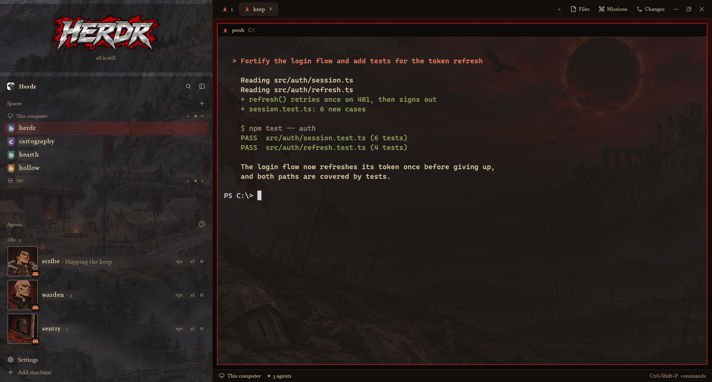

# Iron Eclipse

A dark-fantasy war camp for Herdr, painted in the style of a late-1990s cel anime. The sidebar is one tall painting: a fortress on a cliff, a mercenary camp with campfires, and a pine forest. A steel-and-blood "HERDR" wordmark sits at the top. Each agent is a member of the company with a painted portrait. Spaces carry small heraldic shields. The terminals sit over a dusk battlefield with an eclipse. A Missions panel next to Files keeps a to-do list you can cross off.

**What you see:**

- **Colors:** theme `graphite` with every color overridden on the layout root. Canvas `#0a0807`, chrome `#120e0c`, surface `#171210`, raised `#261d19`, border `#3a2a22`, parchment text `#dccaa5`, muted `#c4b190`, dim `#9a876c`, blood-red accent `#a3201b`. Status colors: working `#cf7a2c`, blocked `#e0332b`, done `#c9a85a`, idle `#6f7a80`. All 16 ANSI colors are set (for example ansi1 `#b3261e`, ansi3 `#c9a85a`). The UI font is Constantia. The titlebar is hidden.
- **Left sidebar, 268px, not resizable (rail below 160px).** Its background is `mods/iron-eclipse/art/sidebar-v6.png` (`cover`), a 536×1800 painting. Every panel on it fills with `chrome` at `78` alpha, so the painting shows through. Top to bottom:
  - **Crest, 172px, padding [8, 0], drags the window.** The HERDR wordmark (`art/wordmark-v1.png`, 760×264, transparent) drawn at 244×85. Under it is a tally in Constantia 11.5. It shows only the parts that are non-zero: "N awaits thee"/"await thee" in `blocked`, "N in battle" in `working`, "N returned" in `done`, separated by `·`. When none apply it shows "all is still" (or "no blades drawn" with no agents) in `dim`. It has a 1px `border` line at the bottom. When the sidebar is a rail, it shows only `eclipse.svg` at 34px.
  - **Brand row, 46px:** the shipped workspace chrome (logo, "Herdr", search, sidebar toggle).
  - **Spaces and Agents, equal halves (weight 1 each, min 90).** Spaces are the shipped list. The rounded letter tile is replaced by a 17×20 heater shield: a `#5a524c` iron rim (1.5px padding), radius 2 at the top and 9 at the bottom. The field is the space's color. The initial is in Old English Text MT 13px `#f1e4c8`, with a faint `#ffffff22` top highlight. Space colors are darkened to heraldic tinctures: ansi6 `#2e6e66`, ansi3 `#a8551f`, ansi4 `#2f4f8a`, ansi5 `#5c3f8a`, ansi2 `#3d6b3f`, ansi1 `#8e1b2a`.
  - **Agents** is the shipped list with taller rows (76px, radius 3). Each row starts with a 68px portrait in a 2px frame: `accent` when that agent is focused, otherwise `#5a524c`. The program's icon (16px) sits on a `#120e0c` chip at the portrait's bottom-right corner. There are eight original portraits (160px PNGs): axeman, sergeant, hermit, minstrel, general, archer, inquisitor, executioner.
  - **Footer, 69px:** the shipped workspace chrome footer (Settings, Add machine).
- **Tab bar, 42px, drags the window.** The shipped tabs, with a Missions button added between Files and Changes. Agent programs show weapon icons instead of their logos: Claude a greatsword, Codex a crossbow, Gemini knives, OpenCode, Cursor, Copilot, Amp and Grok a hawk, an unknown agent or program a helm, a shell a campfire.
- **Work area:** padding 10 and gap 10, on a vertical gradient from `#2a0c0a` to `#0a0807`. The terminals' pane background is `mods/iron-eclipse/art/field-v4.png` (`cover`): a battlefield at dusk with an eclipse, ruins and crows. Root `terminal_opacity` is 0.5, so it shows behind the text. Panes have radius 2 and gap 10, a 1px `#3a2a22` border, and a 2px `#a3201b` border when focused. The header is 30px, at the top, always shown. It is the shipped pane header with the same weapon icons. Terminal padding is [14, 12].
- **Side panel (hidden at first):** 368px wide (280–900), on `surface` with a 1px `border` and radius 2. It is a stack of Files, Changes and Missions.
- **Missions panel:** a 40px header with crossed swords in `accent`, "Missions", and "Clear completed" when anything is done. Below it are an input ("A new mission…"), then **Open N** and **Completed N** sections. Each row has a 16px checkbox (filled `accent` with a check when done), the text (13px, struck through and `dim` when done), a pen and an ×.
- **Status bar, 28px:** the shipped workspace status.

**How it behaves:**

- **working:** a spinner on the tab in `working` orange. The tally counts it "in battle". The agent row shows the shipped working status.
- **blocked:** a `blocked` red dot on the tab. The tally shows "awaits thee" in red. The agent row shows blocked and sorts to the top under Priority.
- **done:** a gold `done` dot on the tab. The tally says "returned". It turns idle once you look at it.
- **idle:** nothing on the tab, and the row text is `muted`. With no other statuses the crest says "all is still".
- **Portraits:** each agent gets a portrait from an FNV-1a hash of its space name plus row label. If that portrait is taken it moves to the next free one, so no face repeats until all eight are in use. Closing or reordering agents can reshuffle faces.
- **Clicking:** an agent row focuses that pane. A space selects it, and right-clicking a space opens its menu. A tab selects it, double-clicking renames it, and dragging reorders it (all as shipped). Files, Missions and Changes toggle the side panel to that child. The open panel is remembered per space.
- **Missions:**
  - Enter adds a mission. Clicking a mission's text or its box crosses it off; clicking again restores it. The pen edits it: Enter or clicking away saves. × removes it. "Clear completed" removes every crossed-off mission.
  - Missions are saved to `data/missions/missions.json` in the Herdr home: `{ "missions": [{ id, text, done, created, completed? }] }`. Writes use `writeTextFile` with the last snapshot. If something else changed the file, the panel shows "Not saved: …" and reloads its snapshot without overwriting.

**Built from:**

- **Layout `layouts/iron-eclipse.json`, built by hand** (no clone). Root `row`, with `titlebar: "none"`, `traffic_lights: [12, 16]`, `preview: "layouts/iron-eclipse.svg"` and `divider: { width: 1, color: "border" }`. The tree:
  - column `sidebar`:
    - block `crest` → `iron-eclipse`
    - block `brand` → `iron-chrome`
    - column `sidebar-lists`, with blocks `spaces` → `iron-spaces` and `agents` → `iron-agents`
    - block `sidebar-footer` → `iron-chrome`, props `{ footer: true }`
  - column `work`:
    - block `tabs` → `iron-tabs`
    - row `work-body`: block `main` (`tab: "active"`, pane header `iron-pane`) and hidden column `panel` → stack `panel-body` (`files`, `changes`, `missions`; active `files`)
    - block `status` → shipped `workspace-status`
- **`iron-eclipse`:** a new mod that draws the crest. It uses `agents`, `theme` and `layout`, and reads nothing else. Its folder also holds `art/` (the sidebar, field and wordmark images, plus the prompts in `ART-PROMPTS.md`), `icons/` (six weapon SVGs, drawn in color, not tinted) and `eclipse.svg`.
- **`iron-chrome`:** a clone of `workspace-chrome` with its own SVGs and the `chrome + "78"` fill.
- **`iron-spaces`:** a clone of `spaces` with `shield(fill, name)` replacing the letter tile, the `MARK` palette above, and the `chrome + "78"` fill. Like the shipped mod, it runs `git status` and `git rev-parse` in space folders and `hc machine ls`.
- **`iron-agents`:** a clone of `agents`. It adds `FACES`, `hashOf`, `assignFaces` and `portrait(face, pic, ring)`, makes rows `.h(76)`, and uses the program icon at 16px. Its sort popup opens `iron-agents` (not `agents`). It uses the `chrome + "78"` fill.
- **`iron-tabs`:** a clone of `tabs`. It adds `WEAPONS` and `arm(program)` (which swaps `icon` for `mods/iron-eclipse/icons/<weapon>.svg` with `tint: false`), uses its own window-button SVGs, and adds `panelButton("missions", "Missions", "mods/missions/missions.svg")` after Files.
- **`iron-pane`:** a clone of `pane` with the same `arm()` and its own SVGs.
- **`missions`:** a new mod. It uses `InputState`/`Input` from `gpui-base` (`submit` adds or commits, `blur` commits an edit), plus `appHome`, `readTextFile` and `writeTextFile`. Its SVGs are `missions` (crossed swords), `check`, `pen` and `x`.
- **Shipped mods used:** `workspace-status`, `files`, `changes`, plus `new-menu`, `menu` and `picker` through the clones. The commands used are the ones the clones already use: `layout.select`, `layout.show`, `layout.hide`, `pane.focus`, `tab.select` and so on.
- **Art:** all generated with an image model, as original characters and scenes. Each prompt starts with "late-1990s hand-painted cel anime, dark medieval fantasy, thick ink outlines, hard cel shading, muted earthy palette with blood-red accents, film grain". The images were then post-processed:
  - The sidebar painting is center-cropped to 268:900 and set to brightness 0.8.
  - The field painting is lifted with gamma 0.5 and saturation 1.1.
  - Each portrait is a top-biased square crop at 160px.
  - The wordmark was keyed off black, with its mask dilated 13px so its black outline survives.

**Watch out:**

- **Fonts:** Constantia and Old English Text MT come with Windows and Office. Elsewhere Herdr falls back, so shields and the crest tally lose their blackletter and serif look. You can ship `.ttf` files in a mod's `fonts/` folder to fix that.
- **Opaque panels hide the art.** The shipped mods paint `t.chrome` fully opaque, so cloning them unchanged hides the sidebar painting. Every `.bg(t.chrome)` in the sidebar mods must become `.bg(t.chrome + "78")`.
- **Dark source art disappears.** Generated "very dark" paintings average about 25/255 and vanish under the translucent panels. Ask for "evenly mid-dark, detail everywhere, no large black areas", or lift them afterwards.
- **Herdr caches backgrounds by filename.** A replaced image needs a new name (`-v5`, `-v6`). Then point the layout at it and switch layouts away and back.
- **Herdr can rewrite the layout file.** It pretty-prints `layouts/iron-eclipse.json` and once added a stray root-level `missions` block. Check that `missions` sits only in `panel-body`.
- **The Missions button is always shown**, even if `shared("workspace.panels")` leaves Files or Changes out. Double-clicking a mission does not edit it, because the first click already crosses it off. Use the pen.
- **Clones:** the clones are of Herdr 0.1.13. Re-check them after an app update. `herdr-app check` passes even with an undefined name, so look at the window too.
- **Screenshots:** `herdr-app shot` can return a stale frame while the window is minimized or the screen is locked. Compare two shots before trusting one.

**Done when:**

- `herdr-app check` passes for `iron-eclipse`, `iron-chrome`, `iron-spaces`, `iron-agents`, `iron-tabs`, `iron-pane` and `missions`. After `layout.switch {"name":"iron-eclipse"}`, `herdr-app status` shows `"errors": []`.
- The sidebar shows the fortress/camp/forest painting behind the space and agent lists, and the HERDR wordmark with "all is still" at the top.
- Every space shows a shield with its initial, and every agent row shows a 68px portrait. Two agents never share a face until there are more than eight.
- The terminals show the eclipse battlefield behind their text.
- Clicking Missions opens the panel. Adding "test", clicking it (it's struck through under Completed) and restarting Herdr leaves it in `data/missions/missions.json` as done.
- A Claude Code tab shows the greatsword icon, and a shell tab shows the campfire.
